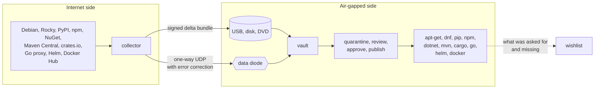

# mirror-every-repo

[](https://github.com/Binchitects/mirror-every-repo/actions/workflows/ci.yml)
[](https://github.com/Binchitects/mirror-every-repo/releases)
[](LICENSE)

**Package repositories for networks that have no internet.**

`mirror-every-repo` keeps apt, RPM, PyPI, npm, NuGet, Maven, Cargo, Go module, Helm and container image repositories available inside an air-gapped network. A collector on the internet side mirrors what you ask for, with its dependencies. Signed bundles carry only what changed across the gap, on removable media or through a one-way data diode. A vault on the inside checks every byte, holds new content in quarantine until someone approves it, and serves it to stock `apt-get`, `dnf`, `pip`, `npm`, `dotnet`, `mvn`, `cargo`, `go`, `helm` and `docker` clients.

It is one binary, `mer`, written in Rust, shipped as a container image.



## Why this exists

General repository managers assume both sides can talk to each other. An air gap breaks that assumption, and the hard parts are exactly the ones they leave to you:

- **The collector never hears back.** It keeps its own ledger of what it has shipped and computes the next delta without any answer from the inside. That is what makes a hardware data diode usable.
- **Transfers are incremental and resumable.** A bundle holds only content the vault does not have. The volumes of a bundle can be inserted in any order; a bad sector costs one segment, not the bundle; a half-received bundle survives a restart.
- **Nothing is served on arrival.** Imported content is a sealed, immutable snapshot that waits for approval. Publishing and rolling back are a single pointer move, so clients never see a half-updated repository.
- **You mirror what you need, not the world.** Name the packages; dependencies are followed the way each ecosystem's own client would resolve them. Requests for things the vault does not have are collected on a wishlist.

## What it does

| | |
|---|---|
| **Formats** | apt (Debian, Ubuntu), RPM (dnf, yum), PyPI, npm, NuGet (.NET), Maven, Cargo (Rust), Go modules, Helm charts, container images (OCI and Docker), plain files |
| **Transfer** | Removable media volumes sized to the medium; one-way UDP with RaptorQ error correction for data diodes |
| **Integrity** | Ed25519-signed bundles with k-of-n signers, a Merkle proof per segment, SHA-256 content addressing, upstream hashes and signatures checked before anything enters a snapshot |
| **Control** | Quarantine with review of what would change, approve or reject, atomic publish, instant rollback, hash-chained audit log |
| **Access** | Web panel users with roles, local or from an LDAP directory; client tokens for private repositories; TLS |
| **Space** | One content-addressed store shared by all formats (a base layer or package is kept once), per-repository quotas, retention, garbage collection |
| **Visibility** | Web panel with charts of downloads, data sent and storage over time; how old each repository's content is; browsing and searching what is mirrored; a wishlist of what clients asked for and did not get; Prometheus metrics |

Stock clients are tested end to end on machines that can reach only the vault: `apt-get install`, `dnf install`, `pip install`, `npm install`, `dotnet restore` with build and run, `mvn package`, `cargo build`, `go build`, `helm pull` and `docker pull` with run.

## Quick start

You need Docker. This runs both sides on one machine to show the whole loop.

```bash
git clone https://github.com/Binchitects/mirror-every-repo.git
cd mirror-every-repo
bash deploy/demo-apt.sh
```

The script starts a collector, a vault on a network with no route out, and a stock Debian client that can reach only the vault. It mirrors `hello` from Debian, carries it across as removable media, installs it with `apt-get`, sends a second bundle through the one-way link, and checks every step. `deploy/demo-formats.sh` does the same for pip, npm, dotnet and docker; `deploy/demo-more.sh` for helm, cargo, go, mvn and dnf (name the ones you want: `bash deploy/demo-more.sh maven rpm`); `deploy/demo-ldap.sh` shows sign-in through an LDAP directory.

## Install

```bash
docker pull ghcr.io/binchitects/mirror-every-repo:1.1.0
```

The image contains the `mer` binary and runs as an unprivileged user with its data in `/data`. A Linux x86-64 binary is attached to each [release](https://github.com/Binchitects/mirror-every-repo/releases).

To build from source, see [Development](#development).

## How you use it

A minimal real deployment is two hosts, each running the image with a volume for `/data` and one for `/keys`.

**Once, to pair the two sides**

```text
collector$ mer init
collector$ mer key gen /keys/bundle.key           # prints the public key
vault$     mer init
vault$     mer key trust /data/trust.txt <public key>
vault$     mer user add admin --role admin        # prints a generated password once
vault$     mer serve --tls-cert /keys/tls.crt --tls-key /keys/tls.key
```

**On the collector, whenever you want to update the inside**

```text
mer repo add debian --format apt
mer apt keygen                                    # site key that clients will trust
mer apt sync debian --upstream http://deb.debian.org/debian --suite bookworm \
    --package nginx --package postgresql-15

mer repo add pypi --format pypi
mer pypi sync pypi --python 3.12 -r requests -r "django>=4.2,<5"

mer repo add npm --format npm
mer npm sync npm -p express -p "@types/node@20"

mer repo add nuget --format nuget
mer nuget sync nuget --framework net8.0 -p Serilog.Sinks.Console -p Newtonsoft.Json@13.0.3

mer repo add hub --format oci
mer oci sync hub -i library/alpine:3.20 -i library/nginx:1.27

mer export seal --key /keys/bundle.key            # one bundle for everything that changed
mer export media --seq 1 --out /mnt/usb           # or: mer export diode --seq 1 --to vault:9000 ...
```

**On the vault**

```text
mer import media /mnt/usb                         # or: mer import diode --link-key /keys/link.key
```

Then open the web panel at `https://vault:8080/ui/`, review what each new snapshot would change, approve it and publish it. The same is available as `mer approve`, `mer publish` and `mer rollback`.

**On client machines inside the air gap**

```text
# apt: /etc/apt/sources.list.d/vault.list
deb [signed-by=/etc/apt/keyrings/site.asc] https://vault:8080/debian bookworm main

pip install --index-url https://vault:8080/pypi/simple/ requests
npm install --registry https://vault:8080/npm/ express
dotnet nuget add source https://vault:8080/nuget/v3/index.json --name vault
docker pull vault:8080/hub/library/alpine:3.20
```

The panel shows these lines for each repository, with your vault's address filled in, under "Client setup".

The full walkthrough, including the data diode, access control, retention and troubleshooting, is in the [operator guide](docs/GUIDE.md).

## Where trust comes from

The vault trusts one thing: the collector's bundle signing key. Every segment of a bundle is verified against that signature before it is stored, whatever route it took.

What the collector trusts upstream depends on the format:

| Format | Trusted | Verified |
|---|---|---|
| apt | The archive signing key | Signature on the release file; every index and package against the signed hashes |
| PyPI | TLS to the index | Every file against the SHA-256 the index states |
| npm | TLS to the registry | Every tarball against the registry integrity hash |
| NuGet | TLS to the feed | Every package against the SHA-512 in the feed catalog |
| Containers | TLS for tag to digest | Every manifest, config and layer against its digest |
| Helm | TLS to the chart repository | Every chart against the SHA-256 in the index |
| Cargo | TLS to the index | Every crate against the SHA-256 in the index |
| Go | TLS to the proxy and the checksum database | Every `go.mod` and source archive against the checksum database |
| Maven | TLS to the repository | Every file against the SHA-1 published next to it |
| RPM | The distribution's signing key | Signature on the repository metadata; every package against it. Packages keep their own signatures for the clients to check |

Upstream signatures are checked for apt and RPM. PyPI attestations, npm registry signatures, NuGet package signatures, Maven signatures and container image signatures are not verified yet.

## Scope and limits

This is a focused tool, not a replacement for every feature of a general repository manager. The main limits:

- Clients can read, not publish. There is no upload path from inside the air gap.
- Sign-in is local users or an LDAP directory, with three roles for the whole vault. There is no OIDC and there are no per-repository permissions yet.
- Dependency selection follows each ecosystem's rules but is not a full solver. What cannot be satisfied is reported and left out.
- Mirroring, sealing and importing are command-line operations. The web panel reviews, decides and reports.
- The wishlist is shown on the vault, with what to add on the collector for each item, and can be downloaded as text. Carrying it back to the collector is a manual step.
- The server is tuned for tens of clients, not thousands.

The complete list, including what is deliberately simpler than the long-term design, is in [docs/STATUS.md](docs/STATUS.md).

## Documentation

| | |
|---|---|
| [Operator guide](docs/GUIDE.md) | Installing, pairing, mirroring each format, both transports, the panel, access control, maintenance, troubleshooting |
| [Status and limits](docs/STATUS.md) | Exactly what is built, what is simplified, what is missing |
| [Architecture](docs/ARCHITECTURE.md) | The long-term target design. It describes more than is built today |
| [Changelog](CHANGELOG.md) | What each release contains |
| [Security policy](SECURITY.md) | How to report a vulnerability |
| [Licensing](LICENSING.md) | AGPL terms in short, and commercial licensing |

## Development

No local Rust toolchain is needed, only Docker.

```bash
bash scripts/dcargo.sh test --workspace
```

```bash
bash scripts/dcargo.sh clippy --workspace --all-targets -- -D warnings
```

```bash
bash deploy/demo.sh
```

The code is a Cargo workspace of small crates (`crates/`), built with Rust 1.99. Version logic for each ecosystem is tested against truth tables generated from that ecosystem's reference implementation (`dpkg`, `rpm`, Python's `packaging`, npm's `semver`, `NuGet.Versioning`, Maven's `ComparableVersion`); the generators are next to the tables in `crates/*/tests/`.

Every push to `main` runs lint, the test suite and an end-to-end demo. Pushing a tag `vX.Y.Z` builds and publishes the container image, the binary and the GitHub Release.

## License

Copyright (C) 2026 Binchitects.

`mirror-every-repo` is free software under the [GNU Affero General Public License, version 3](LICENSE). You may use, modify and redistribute it under those terms. If you offer a modified version to users over a network, the AGPL requires you to make your modified source available to them.

**Commercial licensing.** If the AGPL does not fit your use, for example embedding this in a product you do not want to release under the AGPL, a commercial license is available. See [LICENSING.md](LICENSING.md) for how to get in touch.
